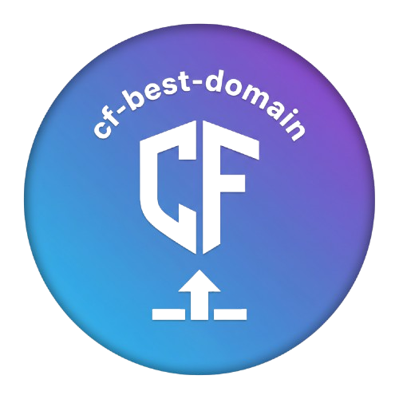

<div align="center">
  <a href="https://github.com/LoveDoLove/cf-best-domain">
    
  </a>

  <h3>cf-best-domain</h3>

  <p align="center">
    <strong>Automated Cloudflare optimal IP discovery and zero-downtime DNS A-record synchronization powered by GitHub Actions.</strong>
    <br />
    <a href="docs/whitepaper.md"><strong>Read Technical Whitepaper »</strong></a>
    <br />
    <br />
    <a href="README.md">English</a>
    ·
    <a href="README_zh.md">简体中文</a>
    ·
    <a href="https://github.com/LoveDoLove/cf-best-domain/issues/new?labels=bug&template=bug-report---.md">Report Bug</a>
    ·
    <a href="https://github.com/LoveDoLove/cf-best-domain/issues/new?labels=enhancement&template=feature-request---.md">Request Feature</a>
  </p>

  <p align="center">
    <a href="https://github.com/LoveDoLove/cf-best-domain/stargazers"></a>
    <a href="https://github.com/LoveDoLove/cf-best-domain/network/members"></a>
    <a href="https://github.com/LoveDoLove/cf-best-domain/actions/workflows/collect_ip_list.yml"></a>
    <a href="https://github.com/LoveDoLove/cf-best-domain/actions/workflows/update_cloudflare_dns.yml"></a>
    <a href="https://github.com/LoveDoLove/cf-best-domain/blob/lovedolove/LICENSE"></a>
    
  </p>
</div>

---

## 📖 Overview

**cf-best-domain** is a lightweight, zero-maintenance, serverless automation toolkit designed to solve routing inefficiencies and high latency for Cloudflare-hosted services.

By combining real-time Anycast node benchmarking with automated Cloudflare DNS management, `cf-best-domain` ensures that client traffic is always directed to the fastest, most reliable Cloudflare edge nodes available in your region—completely free of server or hosting costs.

```
+-----------------+       +--------------------+       +----------------+
|  wetest.vip API | ----> | fetch_wetest_ips.py| ----> |     ip.txt     |
+-----------------+       +--------------------+       +----------------+
                                                                |
                                                                v
+----------------------+       +------------------------+       |
| Cloudflare DNS Zone  | <---- |update_cloudflare_dns.py| <-----+
| (Subdomain A Records)|       +------------------------+
+----------------------+
```

### Why cf-best-domain?

Cloudflare Anycast routing typically assigns edge nodes based on BGP announcements. In certain regions (such as the Asia-Pacific region and Mainland China), ISP peering policies and trans-oceanic congestion often cause traffic to be routed to sub-optimal, distant nodes (e.g. routing Asian requests to the US West Coast).

`cf-best-domain` solves this by:
1. Periodically fetching dynamically benchmarked, lowest-latency Cloudflare edge IPv4 addresses.
2. Synchronizing these optimal IPs directly into your Cloudflare DNS zone as `A` records for specified subdomains.
3. Operating entirely through GitHub Actions cron tasks with automated commit squashing and zero infrastructure costs.

---

## ✨ Features

- ⚡ **Zero-Server Operation**: 100% serverless. Executes on scheduled GitHub Actions cron jobs (`*/30 * * * *`) with no VPS or cloud servers to maintain.
- 🛡️ **Non-Empty Circuit Breaker**: Strict validation safeguards your DNS. If upstream IP discovery fails or returns an empty list, DNS update operations are aborted immediately to prevent accidental record deletion.
- 🧹 **Intelligent Git Squash Engine**: Automatically detects repetitive bot update commits and uses soft-resets with `--force-with-lease` to keep your repository commit history clean and readable.
- 🔁 **Transient Network Resilience**: Built-in 3-stage exponential backoff and retry mechanisms absorb transient connection timeouts between CI runners and external APIs.
- 🎯 **Direct Cloudflare REST API v4 Integration**: Automatically discovers zone IDs, purges stale A records, and provisions fresh optimal IPs with `TTL=1` (auto) and unproxied (DNS-only) mode.
- 🪶 **Minimalist Footprint**: Pure Python 3 standard library + `requests`. Zero heavyweight frameworks, zero complex build chains.

---

## 🚀 Quick Start

### Option A: Fork & Automate via GitHub Actions (Recommended)

1. **Fork this repository** to your personal GitHub account.
2. Navigate to your forked repository: **Settings → Secrets and variables → Actions → New repository secret**.
3. Add the following secrets:
   | Secret Name | Description | Source |
   | --- | --- | --- |
   | `CF_API_TOKEN` | Cloudflare API Token with **Zone:DNS:Edit** permissions | [Cloudflare Dashboard](https://dash.cloudflare.com/profile/api-tokens) |
   | `WETEST_CF2DNS_KEY` | wetest.vip API access key | [wetest.vip](https://www.wetest.vip/) |
4. Go to the **Actions** tab in your repository and enable workflows.
5. Trigger **Update Cloudflare DNS** via **Run workflow** to run your first synchronization immediately!

### Option B: Local / Self-Hosted Execution

You can also run the scripts directly on your local machine or dedicated server:

```bash
# 1. Clone the repository
git clone https://github.com/LoveDoLove/cf-best-domain.git
cd cf-best-domain

# 2. Install minimal dependencies
pip install requests

# 3. Export environment variables
export WETEST_CF2DNS_KEY="your_wetest_key_here"
export CF_API_TOKEN="your_cloudflare_api_token_here"

# 4. Fetch optimal IPs (writes to ip.txt)
python fetch_wetest_ips.py

# 5. Synchronize to Cloudflare DNS
python update_cloudflare_dns.py
```

---

## ⚙️ Configuration Reference

### Subdomain Mapping

In `update_cloudflare_dns.py`, configure the subdomains you want to update inside `subdomain_ip_mapping`:

```python
subdomain_ip_mapping = {
    'api': 'ip.txt',       # Maps api.yourdomain.com -> IP addresses in ip.txt
    # '@': 'ip.txt',       # Use '@' for apex root domain (yourdomain.com)
    # 'cdn': 'ip.txt',     # Add additional subdomains as needed
}
```

> **Note**: The script operates on the first active zone associated with your `CF_API_TOKEN`. Ensure your token has permission for that specific zone.

---

## 🔒 Security Best Practices

- **Principle of Least Privilege**: When creating your Cloudflare API token, grant only `Zone - DNS - Edit` permission scoped to the specific zone being managed. Never use your Global API Key.
- **Zero Hardcoded Secrets**: All API tokens are strictly read from environment variables or GitHub Actions Secrets.
- **Circuit Breaker Guard**: The workflow enforces `[ -s ip.txt ]` verification before invoking DNS modification, preventing any catastrophic record wipes.

---

## 📚 Documentation & Whitepaper

For in-depth architectural analysis, engineering decisions, and system design, explore our comprehensive documentation suite:

| Document | Description |
| --- | --- |
| [Technical Whitepaper (EN)](docs/whitepaper.md) | In-depth whitepaper covering vision, architecture, Anycast optimization, and roadmap |
| [技术白皮书 (中文)](docs/whitepaper_zh.md) | 完整双语技术白皮书：路由机理、系统拓扑、安全模型与演进规划 |
| [System Architecture](docs/architecture.md) | Module boundaries, execution data flows, and runtime constraints |
| [Engineering Decisions](docs/decisions.md) | Architecture Decision Records (ADRs) and rationale |
| [Lessons Learned](docs/lessons.md) | Empirical troubleshooting insights and failure prevention |
| [Configuration Guide](docs/configuration.md) | Step-by-step token setup, permission scoping, and workflow parameters |
| [History & Changelog](docs/history.md) | Deprecated paradigms, legacy file mappings, and architectural evolution |
| [AI Agent Guide](AGENTS.md) | Concise operational manual and constraints for AI Coding Agents |

---

## 🤝 Contributing

Contributions are warmly welcomed! Whether you are fixing bugs, improving documentation, or proposing new features:

1. Fork the project
2. Create your feature branch (`git checkout -b feature/amazing-feature`)
3. Commit your changes (`git commit -m 'feat: add amazing feature'`)
4. Push to the branch (`git push origin feature/amazing-feature`)
5. Open a Pull Request

---

## 📄 License

Distributed under the **MIT License**. See [`LICENSE`](LICENSE) for complete details.

---

<div align="center">
  <sub>Maintained with ❤️ by <a href="https://github.com/LoveDoLove">LoveDoLove</a> and the open-source community.</sub>
</div>
