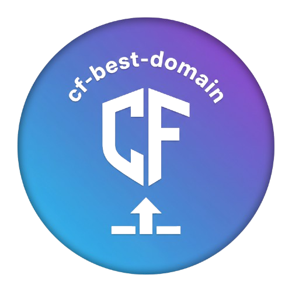

<div align="center">
  <a href="https://github.com/LoveDoLove/cf-best-domain">
    
  </a>

  <h3>cf-best-domain</h3>

  <p align="center">
    <strong>基于 GitHub Actions 的全自动 Cloudflare 优选 IP 抓取与零停机 DNS A 记录智能同步工具。</strong>
    <br />
    <a href="docs/whitepaper_zh.md"><strong>阅读技术白皮书 »</strong></a>
    <br />
    <br />
    <a href="README.md">English</a>
    ·
    <a href="README_zh.md">简体中文</a>
    ·
    <a href="https://github.com/LoveDoLove/cf-best-domain/issues/new?labels=bug&template=bug-report---.md">反馈 Bug</a>
    ·
    <a href="https://github.com/LoveDoLove/cf-best-domain/issues/new?labels=enhancement&template=feature-request---.md">提交建议</a>
  </p>

  <p align="center">
    <a href="https://github.com/LoveDoLove/cf-best-domain/stargazers"></a>
    <a href="https://github.com/LoveDoLove/cf-best-domain/network/members"></a>
    <a href="https://github.com/LoveDoLove/cf-best-domain/actions/workflows/collect_ip_list.yml"></a>
    <a href="https://github.com/LoveDoLove/cf-best-domain/actions/workflows/update_cloudflare_dns.yml"></a>
    <a href="https://github.com/LoveDoLove/cf-best-domain/blob/lovedolove/LICENSE"></a>
    
  </p>
</div>

---

## 📖 项目简介

**cf-best-domain** 是一套轻量、免维护、纯无服务器（Serverless）架构的自动化工具，旨在彻底解决 Cloudflare 节点在国内及亚太地区因默认 Anycast 路由机制导致的跨网延迟高、丢包与绕路问题。

通过将实时优选测速节点画像与 Cloudflare 权威 DNS 解析无缝衔接，`cf-best-domain` 能够全自动将经过测速验证的最优 Cloudflare Anycast IPv4 节点动态绑定至你的自定义域名解析记录中，全程无需自建服务器或负担任何托管费用。

```
+-----------------+       +--------------------+       +----------------+
|  wetest.vip API | ----> | fetch_wetest_ips.py| ----> |     ip.txt     |
+-----------------+       +--------------------+       +----------------+
                                                                |
                                                                v
+----------------------+       +------------------------+       |
| Cloudflare DNS Zone  | <---- |update_cloudflare_dns.py| <-----+
| (子域名 A 记录列表)   |       +------------------------+
+----------------------+
```

### 为什么需要 cf-best-domain？

Cloudflare 默认依赖 BGP Anycast 广播路由调度全球流量。在部分网络环境（特别是中国大陆不同运营商跨网互联以及亚太国际出口链路），默认调度常常将用户访问导向拥堵的远端节点（例如跨洋绕行至美西 PoP 节点），造成访问速度急剧下降。

`cf-best-domain` 提供了最优雅的解决方案：
1. **定时采集**：通过高可用 API 周期性获取实时测速选出的低延迟、低丢包 Cloudflare Anycast IPv4。
2. **精准同步**：调用 Cloudflare REST API v4，将优选 IP 集合直接全量更新为指定子域名（如 `api.yourdomain.com`）的 A 记录。
3. **零成本运转**：完全托管于 GitHub Actions 免费调度引擎中，并内建智能提交压缩机制，永不累积无用提交历史。

---

## ✨ 核心优势

- ⚡ **零服务器依赖（100% Serverless）**：完全依托 GitHub Actions 定时任务（每 30 分钟一次）驱动，无需租用 VPS，无电费与服务器维护成本。
- 🛡️ **非空熔断防护（Circuit Breaker）**：严格的安全防护机制。若上游 IP 获取异常或返回空列表，系统自动中断 DNS 更新流程，坚决杜绝因数据异常清空已有解析记录的灾难。
- 🧹 **智能 Commit 压缩策略**：自动识别定时任务生成的重复提交，采用软重置（Soft Reset）搭配 `--force-with-lease` 策略合并不必要记录，保持仓库历史清爽美观。
- 🔁 **网络瞬态抖动自愈**：内置 3 级重试与退避机制，有效抵御 GitHub Actions CI 节点与外部接口之间的偶发网络抖动与连接超时。
- 🎯 **原生 Cloudflare API 驱动**：根据 Token 自动识别 Zone ID，循环清理已废弃陈旧记录，以 `TTL=1`（自动）与仅 DNS 模式（`proxied=false`）批量建立高效 A 记录解析。
- 🪶 **极简依赖体系**：仅需 Python 3.7+ 标准库及 `requests`，无冗余框架与多余构建链路，CI 运行时间通常小于 20 秒。

---

## 🚀 快速上手

### 方式一：Fork 本仓库并启用 GitHub Actions（推荐，零运维）

1. **Fork 本仓库** 到你的个人 GitHub 账号。
2. 进入你的 Fork 仓库：**Settings → Secrets and variables → Actions → New repository secret**。
3. 添加以下两个必要密钥：
   | 密钥名称 | 描述 | 获取渠道 |
   | --- | --- | --- |
   | `CF_API_TOKEN` | 具备 **Zone:DNS:Edit** 权限的 Cloudflare API 令牌 | [Cloudflare 控制台](https://dash.cloudflare.com/profile/api-tokens) |
   | `WETEST_CF2DNS_KEY` | wetest.vip 优选节点接口密钥 | [wetest.vip 官网](https://www.wetest.vip/) |
4. 切换到仓库的 **Actions** 页面，确保已启用 Workflows。
5. 手动点击 **Update Cloudflare DNS** 工作流中的 **Run workflow**，立即验证第一次全量优选与同步！

### 方式二：本地运行或私有服务器自建

若你希望在本地或私人服务器上独立调度：

```bash
# 1. 克隆代码仓库
git clone https://github.com/LoveDoLove/cf-best-domain.git
cd cf-best-domain

# 2. 安装基础依赖
pip install requests

# 3. 设置环境变量
export WETEST_CF2DNS_KEY="你的_wetest_key"
export CF_API_TOKEN="你的_cloudflare_token"

# 4. 抓取优选 IP 列表（生成 ip.txt）
python fetch_wetest_ips.py

# 5. 更新并同步 Cloudflare DNS A 记录
python update_cloudflare_dns.py
```

---

## ⚙️ 配置说明

### 子域名映射自定义

打开 `update_cloudflare_dns.py`，在 `subdomain_ip_mapping` 字典中添加或修改你需要更新的子域名：

```python
subdomain_ip_mapping = {
    'api': 'ip.txt',       # 将 api.yourdomain.com 解析至 ip.txt 中的 IP
    # '@': 'ip.txt',       # 使用 '@' 代表根域名（yourdomain.com）
    # 'cdn': 'ip.txt',     # 可根据需要添加更多二级子域名
}
```

> **提示**：脚本会自动通过 `CF_API_TOKEN` 查询获取绑定的第一个有效域名 Zone。请确保该 Token 具备对应域名的管理权限。

---

## 🔒 安全与权限建议

- **最小权限原则**：在 Cloudflare 创建 API 令牌时，权限仅需赋予 `区域 (Zone) - DNS - 编辑`，且建议将应用范围严格限定在目标域名上，严禁使用全局 API Key (Global API Key)。
- **密钥零泄露**：仓库已配置严格的敏感信息隔离，所有密钥通过 GitHub Secrets 注入环境变量，严禁写入任何源代码或提交文件。
- **DNS 安全熔断机制**：工作流强制执行 `[ -s ip.txt ]` 空文件判定，确保不会在 IP 列表异常时删除有效解析。

---

## 📚 详细文档与技术白皮书

本项目拥有结构清晰、工程严谨的文档体系，欢迎按需阅读：

| 文档名称 | 内容概览 |
| --- | --- |
| [技术白皮书 (中文版)](docs/whitepaper_zh.md) | 全面解析项目愿景、Anycast 路由优化理论、系统拓扑、安全边界与路线图 |
| [Technical Whitepaper (EN)](docs/whitepaper.md) | English architectural whitepaper: mechanisms, design, and roadmap |
| [系统架构说明](docs/architecture.md) | 核心模块划分、详细数据流向、异常处理与 Runtime 运行约束 |
| [工程决策记录 (ADR)](docs/decisions.md) | 关键架构演进历史、权衡考量与已被锁定的设计原则 |
| [踩坑与经验教训](docs/lessons.md) | 偶发超时、CI 验证、Runner 镜像升级与文档一致性经验总结 |
| [配置与部署指南](docs/configuration.md) | 手把手教你创建 Token、配置 Secrets 与调整工作流参数 |
| [历史与废弃信息](docs/history.md) | 旧文件映射、已废弃方案备忘，避免重复踏坑 |
| [AI Agent 指南](AGENTS.md) | 面向 AI Coding Agent 的高密度工程指引与规则约束 |

---

## 🤝 参与贡献

欢迎社区小伙伴参与改进本项目！无论是修复缺陷、丰富文档还是提交新功能：

1. Fork 本仓库
2. 创建你的特性分支 (`git checkout -b feature/amazing-feature`)
3. 提交代码变更 (`git commit -m 'feat: add amazing feature'`)
4. 推送至远程分支 (`git push origin feature/amazing-feature`)
5. 新建 Pull Request

---

## 📄 开源许可证

本项目遵循 **MIT 开源许可证**。详细条款请参阅 [`LICENSE`](LICENSE)。

---

<div align="center">
  <sub>Maintained with ❤️ by <a href="https://github.com/LoveDoLove">LoveDoLove</a> and the open-source community.</sub>
</div>
